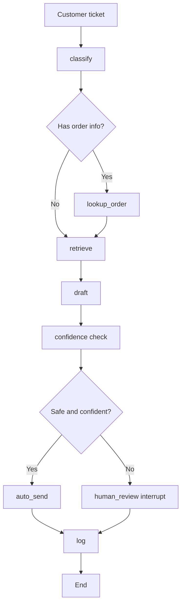

# Support Triage Agent

A LangGraph workflow that turns a customer ticket into a grounded support response while keeping risky cases in human review.


## What this project does

- Classifies the ticket by category, urgency, and sentiment
- Looks up order details when an order ID exists
- Retrieves policy guidance from the KB and vector store
- Drafts a response using the retrieved context
- Escalates low-confidence or risky cases to a human reviewer
- Logs the final route and execution trace for monitoring

This project is meant to reduce repetitive support work while keeping a human in the loop for risky or uncertain cases.

## Why it exists

Support teams spend a lot of time on repetitive tasks such as routing, searching policies, checking orders, and drafting replies. This app automates those steps and keeps the final decision safe with human review when needed.

## High-level architecture



## Core technologies

- LangGraph for orchestration and stateful workflow execution
- LangChain for chat model abstraction and structured outputs
- Pydantic for validated structured responses
- ChromaDB + embeddings for retrieval from knowledge base documents
- SQLite for ticket logging and order data
- Streamlit for the UI
- Langfuse for observability and tracing
- Pytest for automated testing

## Supported LLM providers

The project is configured to work with multiple providers:

- Groq
- Gemini
- NVIDIA

You can switch the main provider via `LLM_PROVIDER` in `.env` and configure fallback providers with `LLM_FALLBACKS`.

The default configuration is set to Gemini.

## Project structure

```text
support-triage-agent/
├── app/
│   ├── __init__.py
│   ├── config.py                 # global config and env settings
│   ├── db.py                    # SQLite helpers
│   ├── graph.py                 # LangGraph workflow definition
│   ├── llm.py                  # model factory and fallback logic
│   ├── observability.py         # Langfuse setup and tracing config
│   ├── prompts.py              # prompt templates
│   ├── schemas.py              # Pydantic response schemas
│   ├── state.py                # graph state definition
│   ├── nodes/
│   │   ├── auto_send.py
│   │   ├── classify.py
│   │   ├── confidence.py
│   │   ├── draft.py
│   │   ├── human_review.py
│   │   ├── log.py
│   │   ├── lookup_order.py
│   │   └── retrieve.py
│   └── tools/
│       ├── kb_search.py
│       └── order_lookup.py
├── data/
│   ├── kb_docs/
│   ├── vectorstore/
│   └── tickets.db
├── scripts/
│   ├── ingest_kb.py
│   └── seed_db.py
├── tests/
│   ├── test_classify.py
│   ├── test_graph_flow.py
│   ├── test_llm_fallback.py
│   ├── test_routing.py
│   └── test_set.json
├── ui/
│   └── app.py
├── .env
├── .gitignore
├── pytest.ini
├── requirements.txt
├── README.md
└── LICENSE (if present)
```

## Workflow details

### 1. Ticket classification
The `classify` node determines:

- category
- urgency
- sentiment
- whether an order ID appears in the message
- whether further context is needed

This is done with a structured LLM response using Pydantic validation.

### 2. Order lookup
If the ticket includes an order number and the category is an order-related one, the workflow performs an order lookup against the local SQLite database.

This can provide details like:

- order status
- customer details
- shipping/delivery information
- refund data
- payment history

### 3. Retrieval
The workflow searches the knowledge base for relevant documents such as:

- refund policy
- shipping policy
- cancellation policy
- customer support guidance
- billing and payment policy

This helps ground the final response in the company policy rather than a generic answer.

### 4. Draft generation
The agent combines:

- customer context
- retrieved documents
- order details
- classification metadata

and writes a customer-facing response.

### 5. Confidence and safety checks
Before sending automatically, the model checks whether the case is low-risk and sufficiently confident.

Examples of risky conditions include:

- angry customer sentiment
- urgent/critical issue
- missing or uncertain facts
- refund amounts over the configured limit
- low confidence score
- missing KB evidence

If any risk threshold is crossed, the workflow pauses for human review.

### 6. Human review
The app can interrupt execution and require a human to:

- approve the drafted reply
- edit the reply before sending
- reject the response entirely

The final decision is then resumed and logged.

### 7. Logging and observability
Every ticket execution is recorded in the SQLite ticket log and can be traced in Langfuse.

This gives you visibility into:

- which node ran
- which model was used
- which documents were retrieved
- the final decision path
- whether a human intervened

## Setup and installation

### 1. Clone the repository

```bash
git clone <your-repo-url>
cd support-triage-agent
```

### 2. Create a virtual environment

```bash
python -m venv .venv
source .venv/bin/activate
```

On Windows:

```bash
.venv\Scripts\activate
```

### 3. Install dependencies

```bash
pip install -r requirements.txt
```

### 4. Configure environment variables
Create a `.env` file in the project root:

```env
# Main LLM provider: groq | gemini | nvidia
LLM_PROVIDER=gemini
LLM_MODEL=

GROQ_API_KEY=
GOOGLE_API_KEY=
NVIDIA_API_KEY=

# Optional fallback providers in order
LLM_FALLBACKS=gemini,nvidia
LLM_MAX_RETRIES=2

# Application thresholds
CONFIDENCE_THRESHOLD=0.75
REFUND_LIMIT=500

# Optional observability
LANGFUSE_PUBLIC_KEY=
LANGFUSE_SECRET_KEY=
LANGFUSE_BASE_URL=https://us.cloud.langfuse.com
```

If you are using Gemini, you only need `GOOGLE_API_KEY` for the main provider.

## Data setup

### Seed fake orders

```bash
python scripts/seed_db.py
```

This creates sample order records in the SQLite database.

### Ingest knowledge base content

```bash
python scripts/ingest_kb.py
```

This loads local documents and policy data into the vector store.

If you want to ingest policy docs without downloading external datasets, you can use a variant depending on the script logic. See the script itself for the available flags.

## Running the app

Start the Streamlit application:

```bash
streamlit run ui/app.py
```

The app provides:

- sample ticket loading
- custom ticket input
- workflow execution trace
- drafted responses
- human approval / edit / rejection controls
- metrics on processed tickets

## Running tests

The project includes a set of tests covering routing, graph flow, classification, and fallback behavior.

```bash
pytest
```

Or run specific suites:

```bash
pytest tests/test_routing.py
pytest tests/test_graph_flow.py
pytest tests/test_classify.py -s
```

## Example flow

A sample workflow can look like this:

1. User enters a ticket about a refund request.
2. The classifier detects category = `REFUND` and urgency = `low`.
3. Order lookup retrieves the customer’s order and refund status.
4. The retriever finds refund policy docs.
5. A grounded reply is drafted.
6. Confidence check sees the issue is safe and low-risk.
7. The system auto-sends the reply.

A more sensitive case could be:

- angry sentiment
- high urgency
- missing order info
- very large refund amount

In that scenario, the workflow will stop for human review.

## Safety model

The confidence logic is designed to prevent the system from sending risky replies automatically.

The app uses rules such as:

- no knowledge base matches
- no order found for an order-related issue
- customer anger detected
- refund above the configured refund threshold
- model confidence below the threshold

This keeps the agent aligned with support policies and reduces the chance of incorrect automated replies.

## Observability

Langfuse is used when keys are provided. It helps trace:

- LLM calls
- retrieval decisions
- logic flow across nodes
- human reviewer actions

This is useful for debugging, prompt tuning, and operational monitoring.

## Troubleshooting

### Import error for NVIDIA package
Make sure the package is installed in the active environment:

```bash
source .venv/bin/activate
pip install langchain-nvidia-ai-endpoints
```

### Streamlit says the file does not exist
Run the app from the project root with:

```bash
streamlit run ui/app.py
```

### No response from the model
Check:

- your `.env` file exists
- the relevant API key is set
- `LLM_PROVIDER` matches the provider you configured
- the fallback chain is valid

### Graph fails during execution
Check logs and current state. Most issues are caused by:

- missing env variables
- invalid provider configuration
- no vectorstore data loaded
- no SQLite order data seeded

## Future improvements

Possible enhancements include:

- adding a reranker for better retrieval quality
- training on more real support tickets
- storing human-edited replies as new training examples
- adding analytics dashboards for ticket trends
- supporting more providers and model switching in the UI
- adding a feedback loop for continuous improvement

## Summary

This project is a practical example of an AI-powered support workflow:

- structured ticket triage
- retrieval-augmented responses
- human oversight for risky cases
- local data + policy grounding
- a real-world LangGraph application that can be extended into production

It is designed to be understandable, adaptable, and easy to run locally while still reflecting realistic support operations.
